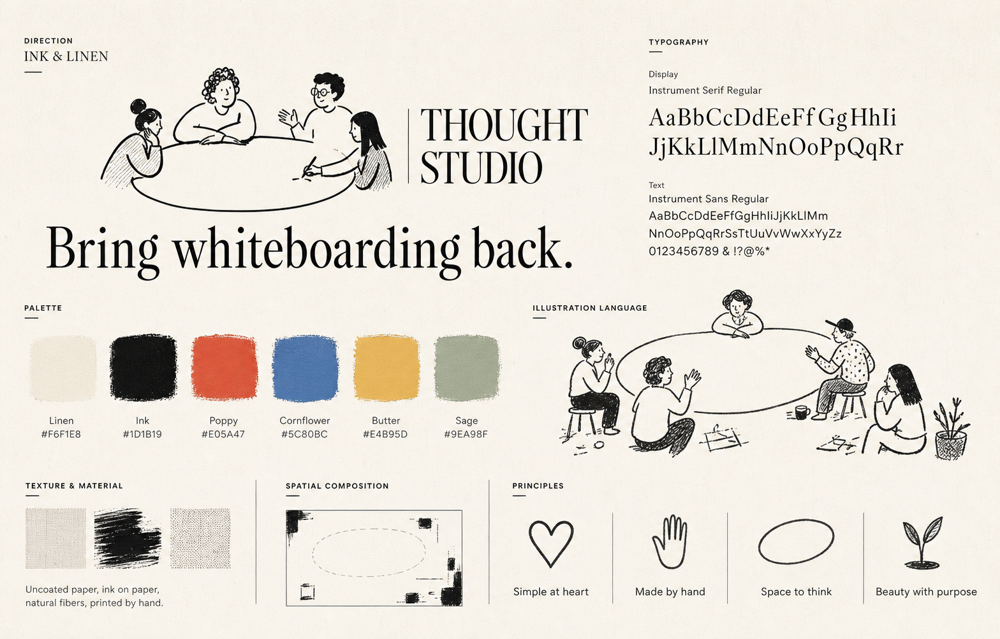
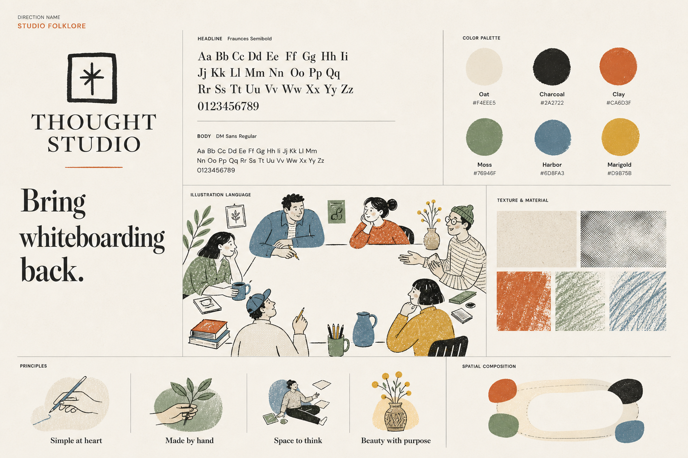
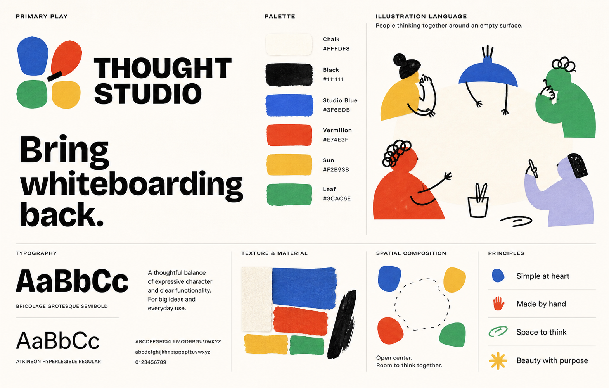
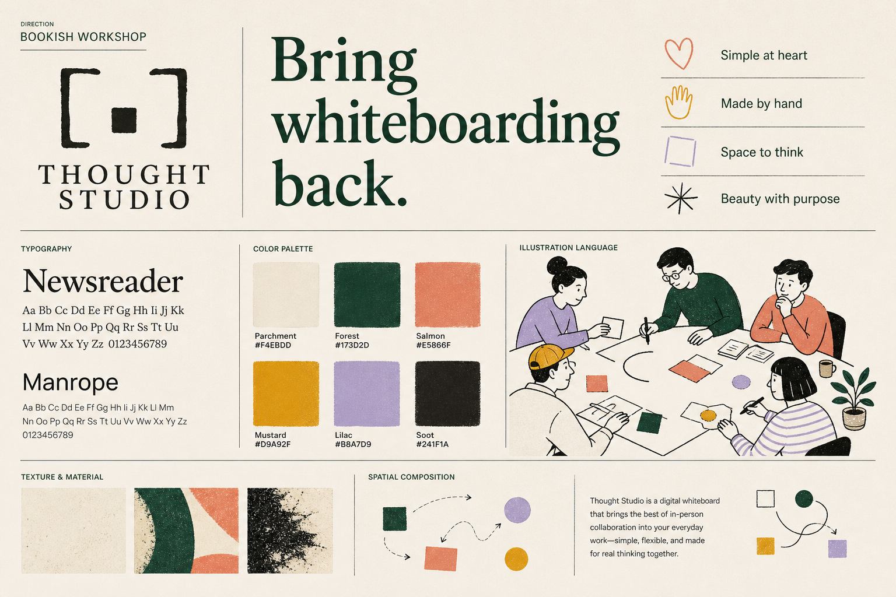
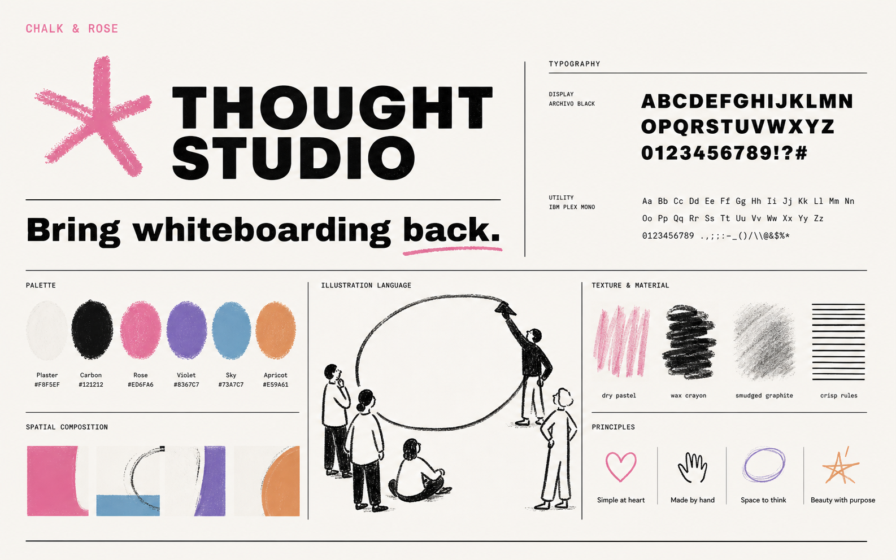
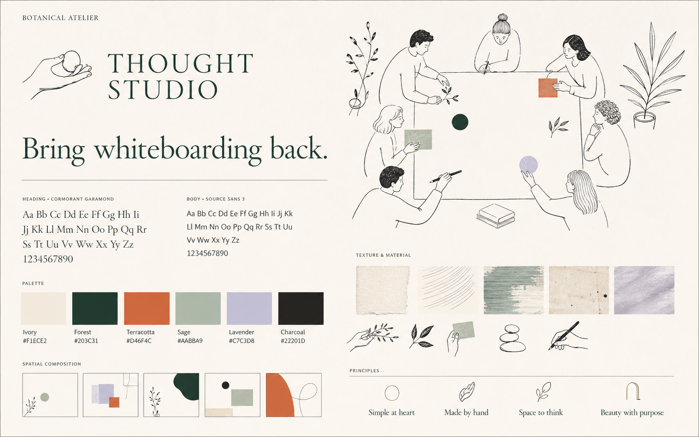
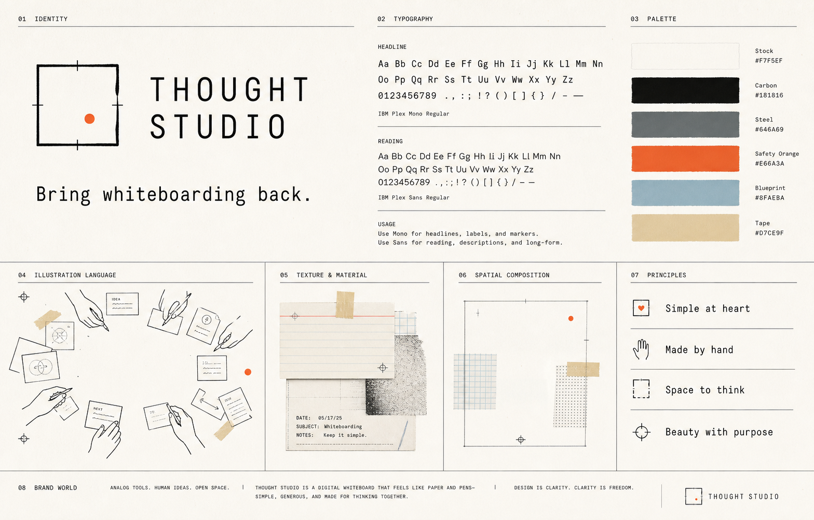
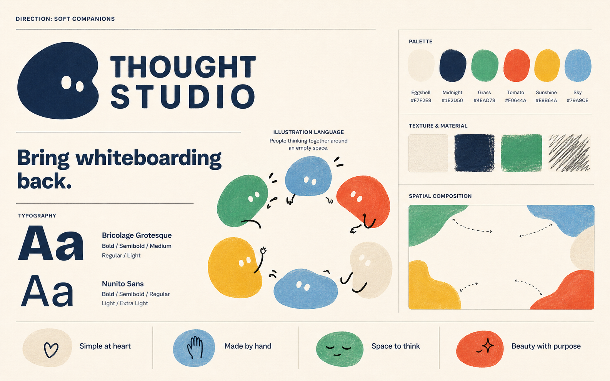
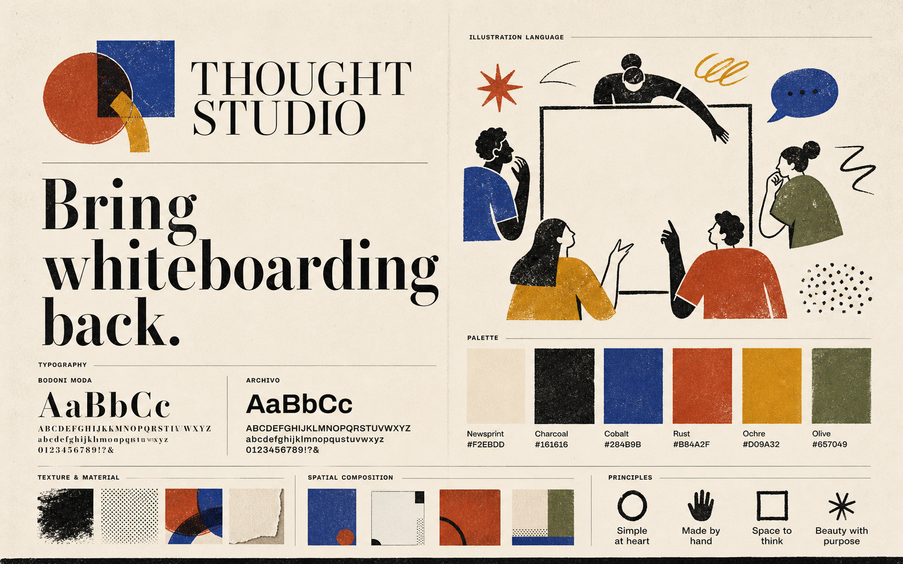
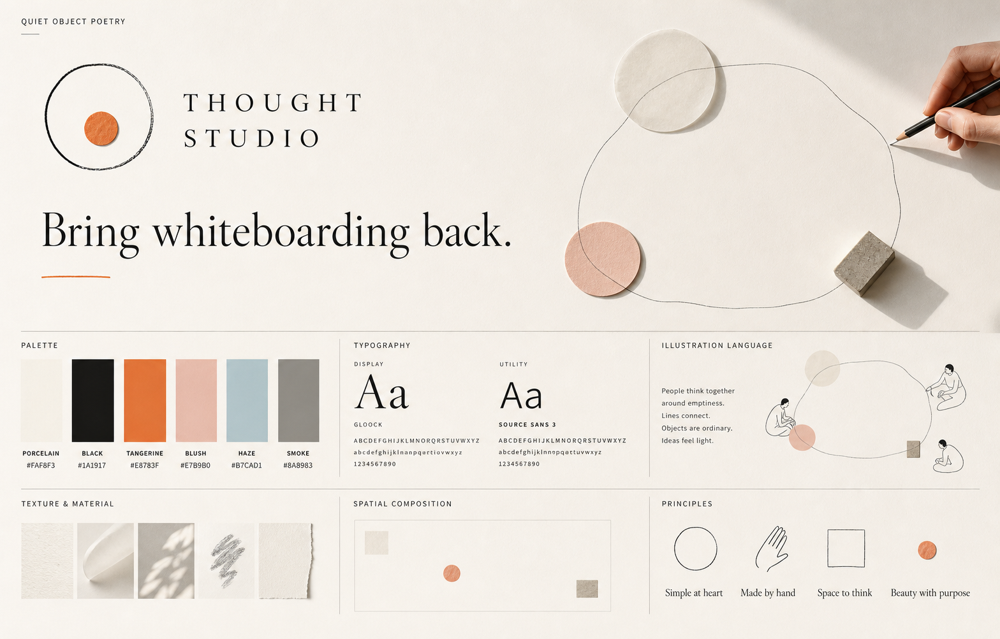

# Artistic brand directions

- **Status:** Direction 03 selected
- **Date:** 2026-08-28
- **Scope:** Brand world, palette, typography, mark, illustration, texture, and spatial character

## Intent

Thought Studio should not look like an AI company wearing the visual language of agents, automation, and futuristic software. The product can be a simple whiteboard while the company feels authored, cultured, human, and beautiful.

These ten boards hold the product promise and evaluation structure constant while varying the artistic system. They are ingredients, not indivisible proposals: the final identity may combine the typography from one direction, palette from another, and illustration or material language from a third.

## How to evaluate

For each direction, react independently to:

1. **Mark:** would it remain meaningful at 16 px and memorable without the name?
2. **Typography:** does the voice feel enduring, readable, and particular to Thought Studio?
3. **Palette:** does it support a mostly blank workspace without becoming sterile?
4. **Illustration:** does it humanize the company without imitating Notion or becoming childish?
5. **Material:** does imperfection add soul while preserving clarity?
6. **Spatial character:** can the brand leave room for user thought?

## Quick comparison

| # | Direction | Strongest quality | Primary tension |
| --- | --- | --- | --- |
| 01 | Ink & Linen | Intimate, timeless editorial humanity | Must differentiate its character language from Notion |
| 02 | Studio Folklore | Communal, cultured, and gently eccentric | Could become too lifestyle-illustration-led |
| 03 | Primary Play | Direct, optimistic, and highly memorable | Could feel like a consumer or children's product |
| 04 | Bookish Workshop | Serious creative practice with warmth | May feel visually dense beside a blank canvas |
| 05 | Chalk & Rose | Energetic authorship and visual confidence | Expressiveness may date faster |
| 06 | Botanical Atelier | Cultivated, calm, and genuinely beautiful | Could drift toward wellness or environmental branding |
| 07 | Monotype Studio | Physical credibility and disciplined system logic | Could become too procedural or austere |
| 08 | Soft Companions | Kind, recognizable, and welcoming | Could let mascots dominate the product identity |
| 09 | Modernist Printshop | Bold cultural authority and print richness | May be too loud for everyday product use |
| 10 | Quiet Object Poetry | Emotional restraint and gallery-level art direction | Harder to translate into compact product chrome |

## 01 — Ink & Linen

Instrument Serif and Sans, warm linen, black pen figures, and small muted color. The closest to an intimate sketchbook or independent magazine.

## 02 — Studio Folklore

Soft serif typography, earthy color, halftone, pencil, and communal scenes. Warm and storied without being nostalgic.

## 03 — Primary Play

Expressive grotesk typography, cut-paper primary color, and abstract human forms. The clearest high-energy direction.

**Selected as the Thought Studio brand foundation.** The canonical system and its blank-canvas application are defined in [Visual identity foundation](BRAND_FOUNDATION.md).

## 04 — Bookish Workshop

Humanist serif type, forest and parchment, screenprint texture, and people visibly constructing a system together.

## 05 — Chalk & Rose

Heavy graphic typography, dry pastel, wax crayon, and a single energetic mark. The most expressive and irreverent direction.

## 06 — Botanical Atelier

Art-book serif typography, quiet contour drawing, natural color, and carefully composed negative space. The most cultivated direction.

## 07 — Monotype Studio

Monospaced typography, registration marks, cards, tape, and photocopy traces. A design tool that feels like an analog instrument.

## 08 — Soft Companions

Rounded forms, matte gouache, warm primary color, and small gestures of personality. Friendly without relying on technological spectacle.

## 09 — Modernist Printshop

High-contrast serif type, bold screenprint geometry, newsprint, overprint, and culturally confident illustration.

## 10 — Quiet Object Poetry

Poetic serif typography, ordinary physical objects, soft daylight, cut paper, and an enormous field of silence. Beauty through composition rather than decoration.

## Generation approach

The boards were generated with the built-in ImageGen tool. Every prompt used the same required anatomy and product principles while assigning a distinct type pairing, six-color palette, mark idea, illustration grammar, material language, and spatial behavior. The supplied references were used as mood and craft references only; no reference brand, logo, or character system is intended to be copied.

## Selection outcome

Primary Play is selected as the base system and palette. Its final brand foundation preserves the direction's expressive typography, primary color family, handmade material language, and open-center composition while constraining their use inside the product.
