# Blank canvas directions

- **Status:** Direction 09 selected
- **Date:** 2026-08-28
- **Scope:** The empty canvas/workspace only

## What remains fixed

The v1 exploration established a useful product shell but the canvas itself felt too warm, tactile, and reminiscent of an old physical whiteboard. This set keeps the approved compact header—with **Thought Studio**, **Untitled**, **Private canvas**, and the account tile—while reimagining the workspace as a contemporary, natively digital field.

Every direction intentionally excludes objects, tools, prompts, sidebars, collaborators, and interactions. The board is empty by design.

## Evaluation lens

Choose the direction that best balances:

- **Blankness:** space for thought without an imposed starting structure.
- **Identity:** recognizable as Thought Studio even before content exists.
- **Digitality:** impossible to mistake for paper or a physical whiteboard.
- **Calm:** visually alive without competing with future thinking.
- **Extensibility:** able to support dense, mixed media and agent activity later.

## 01 — Polar Lattice

An almost-white spatial field with a very restrained coordinate lattice and soft cool illumination. Systematic without feeling technical.

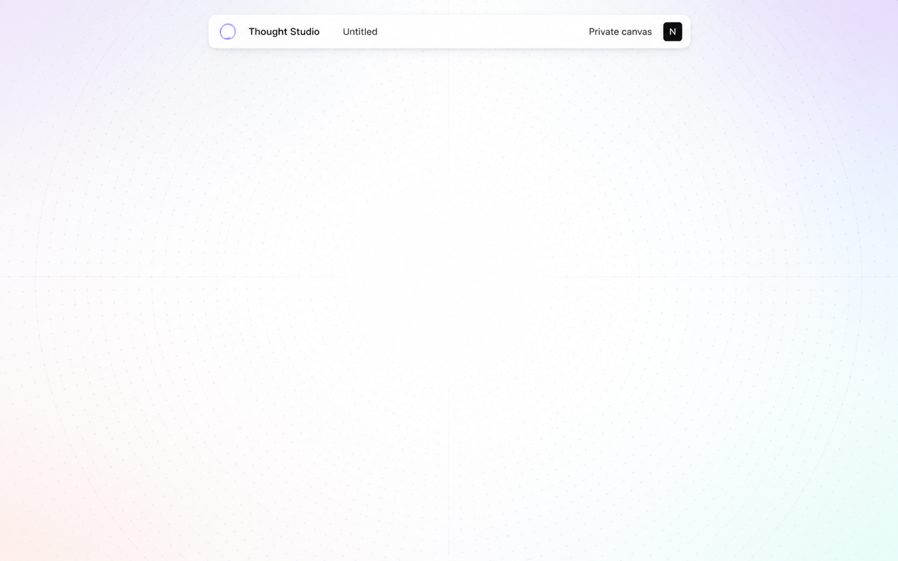

## 02 — Soft Prism

A clean white center surrounded by diffused lavender, blue, mint, and blush light. Warmth comes from color and atmosphere rather than material texture.

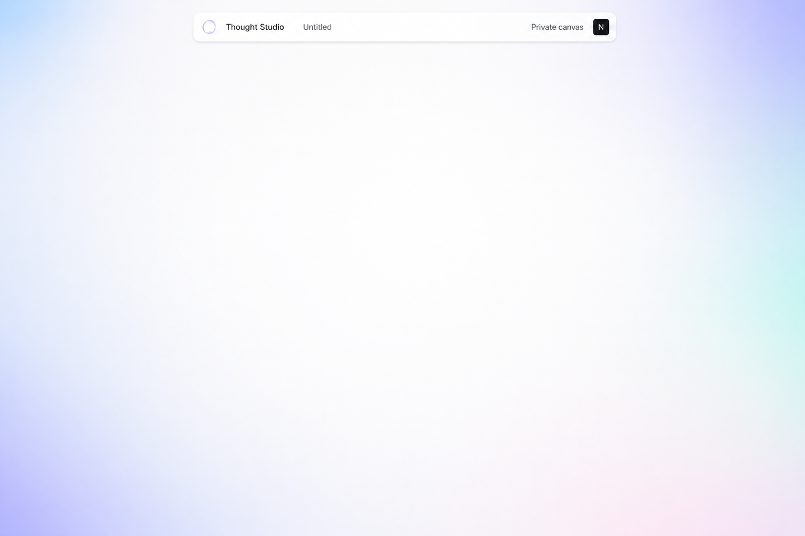

## 03 — Monochrome Precision

Cool white, faint micro-dots, and minimal calibration marks. The most utilitarian and infrastructure-like light direction.

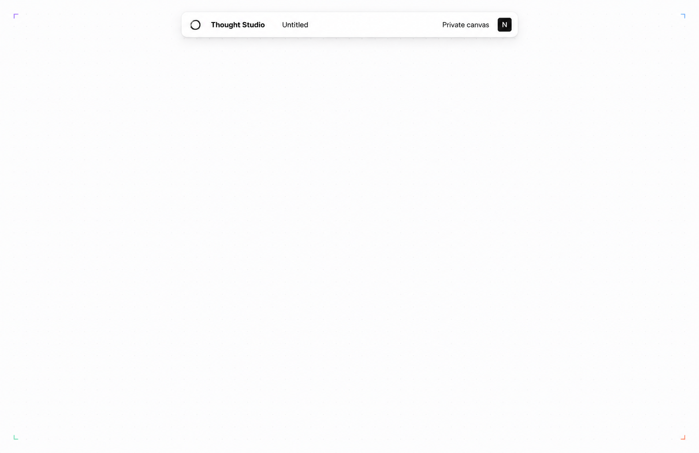

## 04 — Frosted Cloud

A pale neutral field shaped by enormous translucent depth waves. Quiet, dimensional, and intentionally free of a conventional grid.

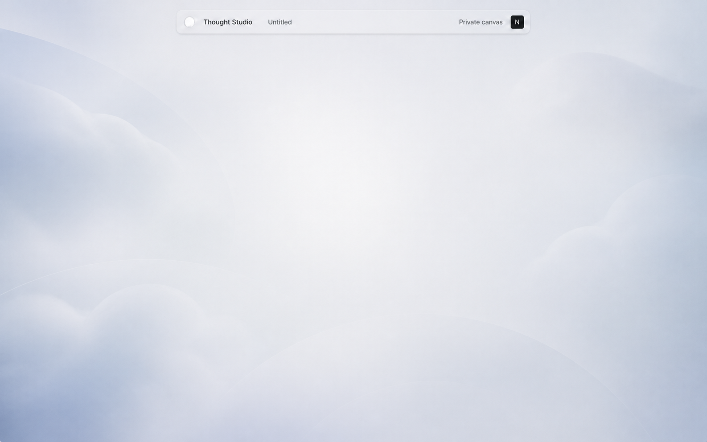

## 05 — Lavender Atmosphere

An icy-lilac field whose micro-dot system recedes toward the center. Softer and more expressive while preserving an empty working area.

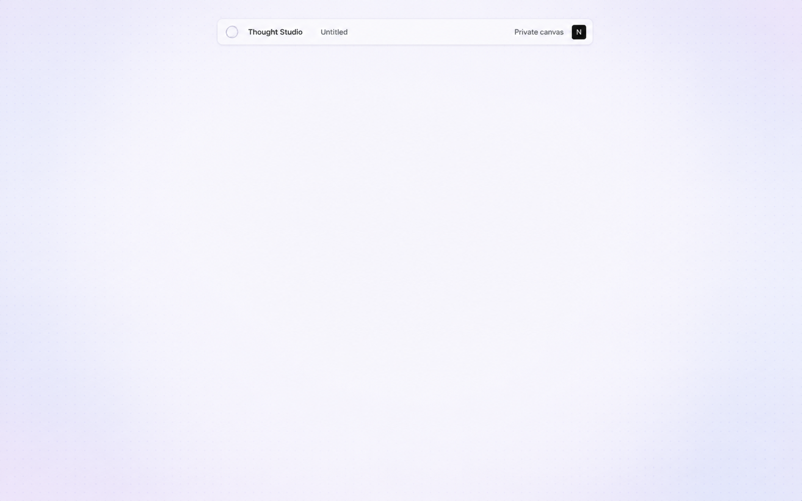

## 06 — Graphite Night

A dark digital canvas with a quiet coordinate field and cobalt-violet perimeter light. This is dark software—not a chalkboard.

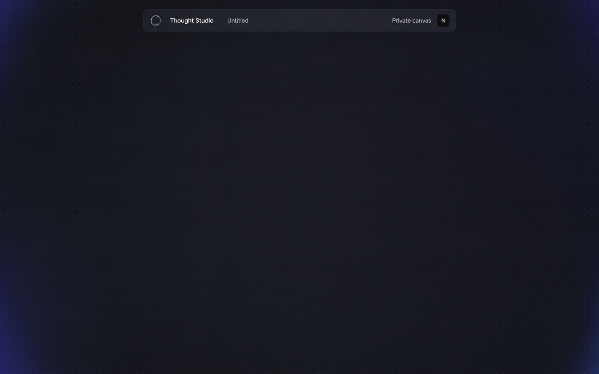

## 07 — Playful Modular

A pristine white center framed by cropped translucent geometry and thin calibration lines. The friendliest and most modular direction.

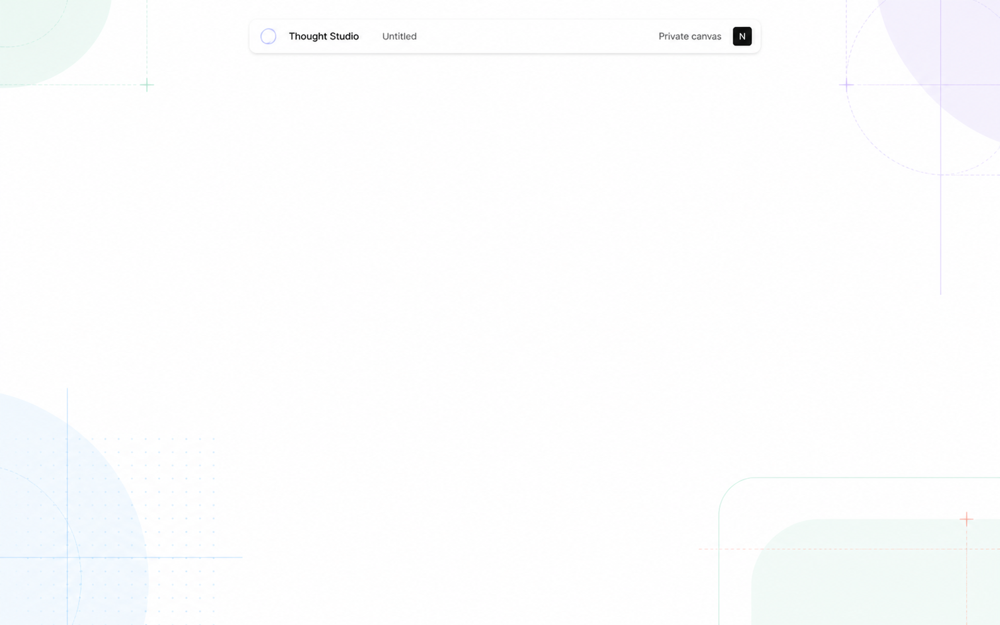

## 08 — Glass Horizon

Bright white with large horizontal layers of nearly invisible frosted depth. Spatial and architectural without resembling a page.

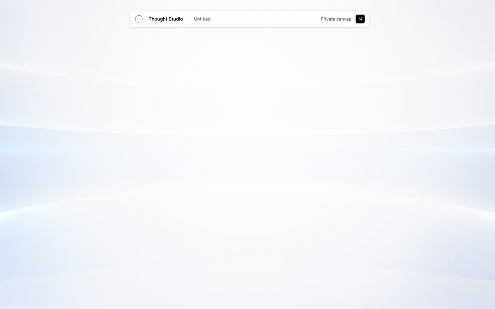

## 09 — Editorial White

Pure white, exceptional restraint, and a barely visible coordinate field. The closest expression of Notion-like clarity and confidence.

**Selected as the canvas foundation.** The first attempt to extrapolate its restraint into the whole brand was too clinical and has been archived. Brand identity is being explored separately in [Artistic brand directions](ARTISTIC_BRAND_DIRECTIONS.md).

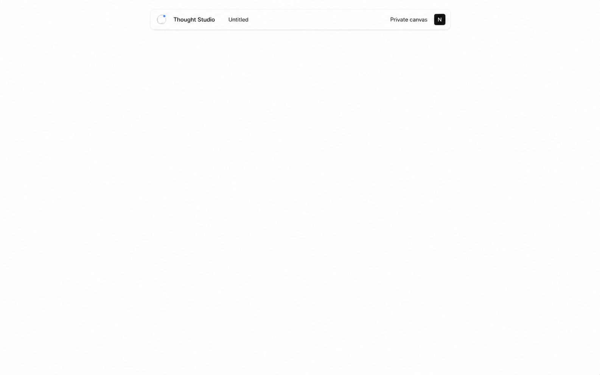

## 10 — Spatial Aurora

A calm white center held by a soft perimeter of cobalt, lavender, cyan, and coral light. The most expressive version of digital blankness.

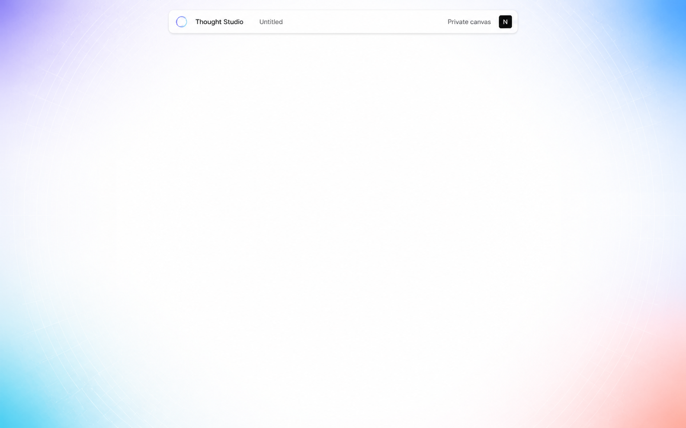

## Generation approach

These mockups were generated with the built-in ImageGen tool. The common prompt held the approved header and absolute blankness constant, rejected physical-whiteboard cues, and varied only the canvas identity: grid, light, depth, color, and edge geometry.

## Decision

Editorial White remains the behavioral foundation for blankness and restraint. Primary Play is the selected brand system layered onto it.

## Primary Play application

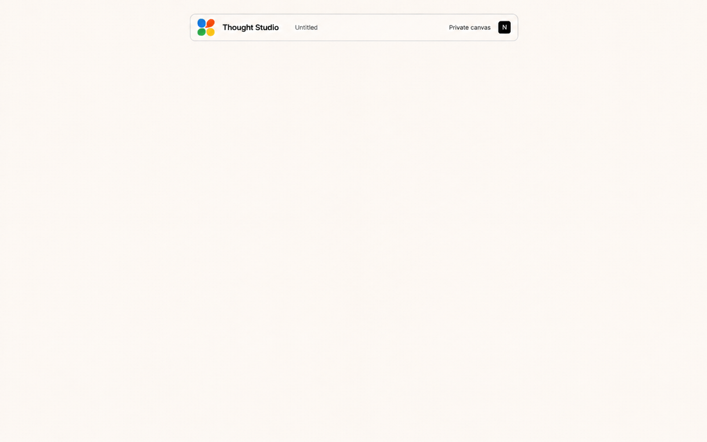

This v5 mockup preserves the Editorial White center while applying the accepted Primary Play identity through typography, the Thought Bloom, the Chalk ground, and an almost invisible micro-dot field. The canvas perimeter stays empty. The logo lobes retain softly smudged painted edges, but their visual weight is balanced around clean negative space without an inward connector. Its exact styling rules are defined in [Visual identity foundation](BRAND_FOUNDATION.md).
