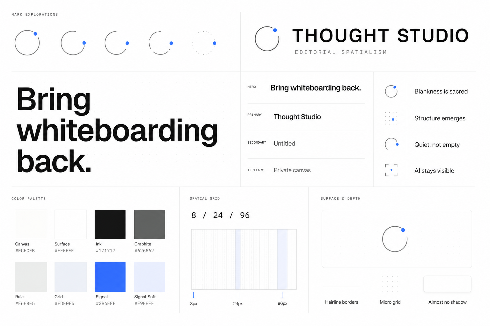

# Visual identity foundation

- **Direction:** Editorial Spatialism
- **Status:** Proposed foundation v0.1
- **Date:** 2026-08-28
- **Source:** Blank canvas direction 09, Editorial White
- **Scope:** Brand primitives and visual styling; no UI components

## Brand idea

**Editorial Spatialism** gives Thought Studio the clarity of an editorial system and the openness of a spatial environment.

The product should feel quiet before thought begins, precise while thought takes shape, and calm even after the board becomes complex. Thought Studio supplies orientation rather than decoration.

## Styling and branding board

The board was generated with the built-in ImageGen tool using Editorial White as the primary visual reference. This document is the source of truth for exact values; the board communicates the intended gestalt.

Machine-readable values are maintained in [`brand/tokens.json`](brand/tokens.json).

## Identity mark: Open Orbit

The mark combines:

- an incomplete graphite orbit: thought is always capable of changing;
- a cobalt point: the current focus, contribution, or active intelligence;
- open space: the system does not close around the user too early.

### Mark rules

- Keep the orbit open and the point distinct.
- Use the graphite-and-cobalt mark on light backgrounds.
- Use a white orbit with the same cobalt point on dark backgrounds.
- Minimum digital size: 16 px.
- Clear space: at least one point diameter around the mark.
- Do not fill the orbit, add gradients, rotate it arbitrarily, or introduce additional points.

## Wordmark

- Product name: **Thought Studio**
- Typeface: **Geist Sans**, weight 600
- Tracking: `-0.025em` in title case
- Presentation lockup: uppercase is allowed at `0.08em` tracking
- The mark and wordmark may appear together or independently when context is already clear.

## Color system

The interface is neutral by default. Cobalt is a signal, not decoration.

| Token | Value | Role |
| --- | --- | --- |
| `color.canvas` | `#FCFCFB` | Infinite workspace and page ground |
| `color.surface` | `#FFFFFF` | Floating surfaces and elevated regions |
| `color.ink` | `#171717` | Primary text and decisive structure |
| `color.graphite` | `#626662` | Secondary text, mark orbit, quiet controls |
| `color.rule` | `#E6E8E5` | Hairline divisions and surface boundaries |
| `color.grid` | `#EDF0F5` | Spatial calibration and micro-dot fields |
| `color.signal` | `#3B6EFF` | Focus, orientation, active intelligence |
| `color.signal-soft` | `#E9EEFF` | Selected or focused environment tint |

### Color rules

- Neutral colors should occupy at least 95% of an empty or lightly populated view.
- Use cobalt only when the interface needs to communicate orientation, agency, focus, or an active state.
- Never use cobalt as a large decorative field.
- Content introduced by users may bring its own color; product chrome should not compete with it.
- Semantic success, warning, danger, collaborator, and agent palettes remain intentionally undefined until their behaviors exist.

## Typography

### Families

- **Primary:** Geist Sans
- **Technical:** Geist Mono for coordinates, token values, shortcuts, and system metadata
- **Fallback:** `Inter, ui-sans-serif, system-ui, sans-serif`

### Type scale

| Style | Size / line | Weight | Use |
| --- | --- | --- | --- |
| Display | `64 / 64` | 600 | Brand statements and major editorial moments |
| Heading 1 | `40 / 44` | 600 | Primary view or document title |
| Heading 2 | `28 / 34` | 600 | Major section title |
| Title | `18 / 24` | 600 | Object or region title |
| Body | `15 / 23` | 400 | Default reading text |
| Label | `12 / 16` | 500 | Interface labels and compact navigation |
| Metadata | `11 / 16` | 400 | Quiet state, coordinates, timestamps |

### Typography rules

- Prefer sentence case in the product.
- Use short lines and strong hierarchy rather than excessive weight changes.
- Avoid decorative type, italics as atmosphere, and serif fonts in product chrome.
- Monospace communicates system precision; it should never become the dominant voice.

## Spatial system

The system has three nested scales:

| Scale | Value | Purpose |
| --- | --- | --- |
| Unit | `8 px` | Local spacing and alignment |
| Rhythm | `24 px` | Repeated layout rhythm and micro-grid interval |
| Field | `96 px` | Large spatial cadence on the infinite canvas |

### Canvas calibration

- Default micro-dot diameter: `1 px`.
- Default micro-dot interval: `24 px`.
- Default micro-dot color: `color.grid` at 55–70% opacity.
- The grid may fade toward the area of focus and should never read as graph paper.
- A major spatial reference may occur every `96 px`, but it should remain below conscious attention until needed.

## Surfaces and depth

- Default surface: `color.surface` on `color.canvas`.
- Border: `1 px solid color.rule`.
- Default radius: `12 px`; large floating regions may use `16 px`.
- Default lift: `0 1px 2px rgb(23 23 23 / 0.04), 0 8px 24px rgb(23 23 23 / 0.03)`.
- Prefer borders, contrast, and spacing over shadow.
- No glassmorphism, paper texture, faux material, heavy blur, or dramatic elevation.

## Iconography

- Geometric outline icons with rounded terminals.
- Stroke width: `1.5 px` at 20–24 px sizes.
- Standard sizes: `16`, `20`, and `24 px`.
- Default color: `color.graphite`.
- Cobalt may identify the active point, never every icon in a group.

## Motion character

- Quiet, direct, and spatially legible.
- Default duration: `160 ms`.
- Enter or relocate: `220 ms`.
- Easing: `cubic-bezier(0.2, 0.8, 0.2, 1)`.
- Avoid bounce, elastic motion, decorative looping, and motion that obscures lineage.

## Brand principles

1. **Blankness is sacred.** The interface does not fill silence to prove value.
2. **Structure emerges.** Visual order follows understanding rather than preceding it.
3. **Quiet, not empty.** Restraint should still feel intentional and alive.
4. **AI stays visible.** Intelligence has an identifiable point of presence and action.

## Explicitly deferred

- Component anatomy and variants
- Interaction states
- Content object styling
- Semantic status colors
- Collaborator and agent identity colors
- Dark mode
- Illustration and marketing imagery

These decisions should be made only after this foundation is accepted.
