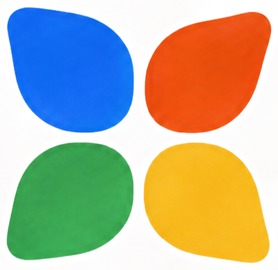
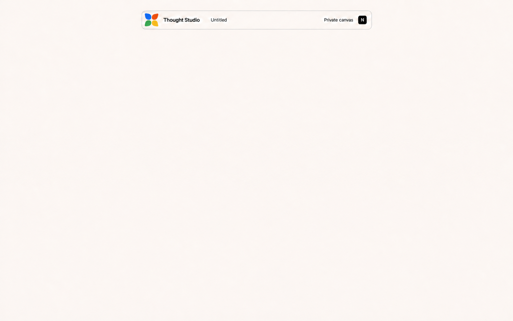

# Visual identity foundation

- **Direction:** Primary Play
- **Status:** Accepted foundation v1
- **Date:** 2026-08-28
- **Scope:** Brand system, palette, typography, illustration, material character, and canvas application

## Brand idea

**Primary Play** makes a simple whiteboard feel authored, optimistic, and human without making the product itself complicated.

The identity uses confident black typography, matte primary color, imperfect hand gestures, and an open center. Beauty comes from character and composition rather than technological spectacle.

## Selected brand board

Machine-readable foundation values are maintained in [`brand/tokens.json`](brand/tokens.json).

## Identity mark: Thought Bloom

The mark is a four-lobed, hand-painted bloom made from Studio Blue, Vermilion, Leaf, and Sun. The four petals gather around a clean open center.

It represents different perspectives gathering around an open center.

The selected geometry uses four distinct outward-facing petals. Each petal has a short organic taper at its outside corner and a broad, rounded edge facing the center. This silhouette is the canonical mark.

### Mark rules

- Preserve the four-color balance and visible handmade edge.
- Keep the selected outward-facing petal silhouette; do not replace the petals with circles or generic rounded squares.
- Let each petal retain slight organic asymmetry while keeping comparable visual weight and distance from the open center.
- Keep the center open: do not add an inward line, notch, stem, or connector to any petal.
- Use a one-color black version when reproduction requires it.
- Minimum digital size: 18 px.
- Do not add gradients, faces, dimensional effects, or additional lobes.
- Use [`brand/thought-bloom-mark-selected.png`](brand/thought-bloom-mark-selected.png) as the selected visual source of truth. A production vector must be traced from this asset without changing the silhouette.

## Color system

| Token | Value | Role |
| --- | --- | --- |
| `color.chalk` | `#FFFDF8` | Canvas and dominant brand ground |
| `color.black` | `#111111` | Typography, structure, and hand-drawn gesture |
| `color.studio-blue` | `#3F6EDB` | Primary orientation and brand recognition |
| `color.vermilion` | `#E74E3F` | Energy, emphasis, and authored action |
| `color.sun` | `#F2B93B` | Invitation, optimism, and gentle attention |
| `color.leaf` | `#3CAC6E` | Growth, connection, and constructive state |

### Color rules

- Chalk should dominate the working product surface.
- Product chrome is primarily Chalk and Black.
- The four colors should behave as a family; no single color becomes the universal software accent.
- Use color to orient, differentiate, and communicate—not to decorate empty space.
- Preserve an open, quiet center even when color appears at the perimeter.
- Semantic and collaboration color mappings remain deferred until their behaviors are designed.

## Typography

### Families

- **Display and identity:** Bricolage Grotesque
- **Reading and utility:** Atkinson Hyperlegible
- **Fallback:** `Arial, ui-sans-serif, system-ui, sans-serif`

### Type scale

| Style | Family | Size / line | Weight |
| --- | --- | --- | --- |
| Display | Bricolage Grotesque | `64 / 64` | 650 |
| Heading 1 | Bricolage Grotesque | `40 / 44` | 650 |
| Heading 2 | Bricolage Grotesque | `28 / 34` | 600 |
| Title | Bricolage Grotesque | `18 / 24` | 600 |
| Body | Atkinson Hyperlegible | `15 / 23` | 400 |
| Label | Atkinson Hyperlegible | `12 / 16` | 700 |
| Metadata | Atkinson Hyperlegible | `11 / 16` | 400 |

### Typography rules

- Use Bricolage for identity, hierarchy, and expressive editorial moments.
- Use Atkinson for sustained reading and compact product information.
- Prefer sentence case in product UI.
- Reserve all caps for compact brand labels and designed editorial moments.
- Let size and composition create energy; do not rely on excessive weight everywhere.

## Illustration language

- Build figures from irregular fields of flat color and sparse black gestures.
- Keep an empty surface or open center as the compositional anchor.
- Use human poses that show thinking, listening, placing, and connecting.
- Vary body shapes and gestures; do not create a uniform mascot cast.
- Never imitate Notion's character proportions, faces, or line vocabulary.
- Illustrations belong in brand, education, empty states, and celebration—not permanently on the active board.

## Texture and material

- Matte gouache edges
- Light paper tooth inside colored marks
- Imperfect black marker or pencil line
- Slightly uneven geometry
- No aged paper, stains, sepia, skeuomorphic whiteboard material, glossy 3D, or simulated office surfaces

Texture provides authorship in marks and illustrations. The canvas itself remains digitally calm.

## Spatial character

- Keep the center open.
- Place expressive color near identities, boundaries, and moments of orientation.
- Use an `8 / 24 / 96 px` spatial rhythm for local, repeated, and field-level alignment.
- Allow slight visual irregularity inside a precise underlying layout.
- Prefer one memorable gesture over many small decorations.

## Applied blank canvas

The blank board applies Primary Play without turning the workspace into a poster:

- Chalk occupies at least 96% of the empty view.
- The Thought Bloom and expressive wordmark carry the identity.
- The canvas perimeter remains completely clear so the empty workspace feels calm and intentional.
- The micro-dot field nearly disappears through the central thinking area.
- No tools, prompts, content, collaborators, or agents appear before the user acts.

## Brand principles

1. **Simple at heart.** The product remains immediately understandable.
2. **Made by hand.** Small imperfections reveal authorship and care.
3. **Space to think.** Identity never consumes the user's working surface.
4. **Beauty with purpose.** Every expressive choice improves orientation, feeling, or meaning.

## Explicitly deferred

- Additional horizontal, stacked, and one-color production lockups
- Component anatomy and states
- Semantic color assignments
- Collaborator and agent identity colors
- Dark mode
- Motion details

These should be designed from this accepted foundation rather than imported from the archived Editorial Spatialism proposal.
