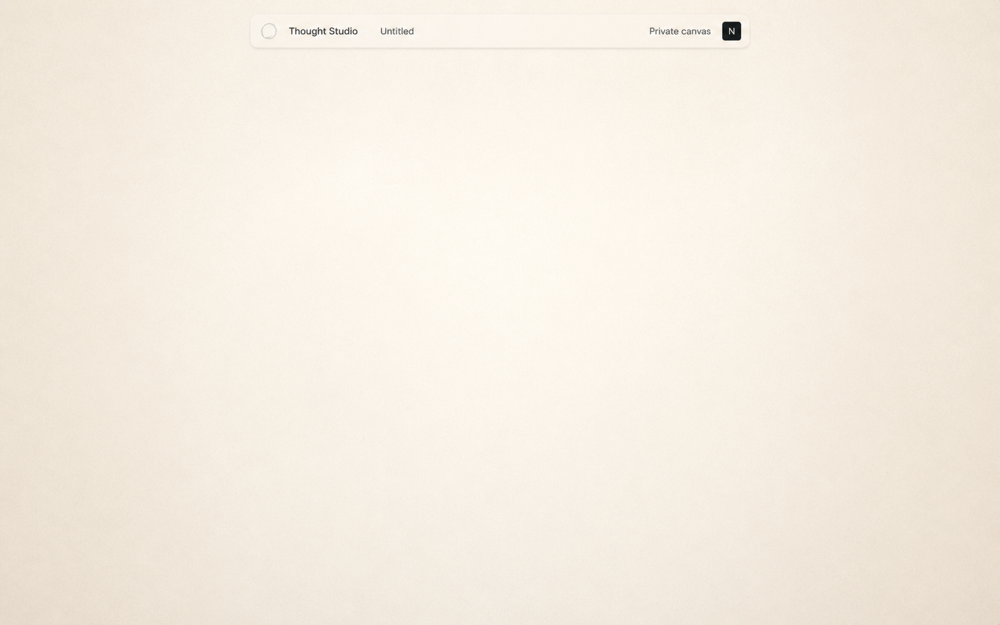

# Blank canvas mockup

- **Status:** Visual exploration v1
- **Date:** 2026-08-28
- **Scope:** The empty canvas/workspace only

## Definition

In Thought Studio, **whiteboard** means the blank spatial canvas and workspace. It does not mean that the first design must include literal drawing tools or conventional whiteboarding features.

This mockup intentionally stops before objects, interactions, toolbars, Sources, collaborators, agents, and Creations.

## Direction: Quiet Field

The canvas is a warm, nearly white continuous field. A soft central brightness provides focus without creating a visible page boundary. Fine texture prevents the space from feeling sterile.

The only interface is a restrained floating identity bar containing:

- Thought Studio
- The Board title
- Its privacy state
- The current account

There is no grid, sidebar, toolbar, prompt, template, illustration, or call to action.

## Mockup

## Review questions

- Does the canvas feel warm and premium or merely beige?
- Does the empty field feel inviting without instruction?
- Is the floating identity bar too prominent?
- Should the canvas be more neutral, brighter, or more tactile?
- Does the space feel continuous without a visible grid?

## Explicitly deferred

- All interactions
- All canvas objects
- Drawing and ink
- Pan and zoom behavior
- Connections and Frames
- Source embedding
- Human collaboration
- Agent presence and actions
- Creation workflows

No interaction specification should be produced until this visual direction is reviewed.
